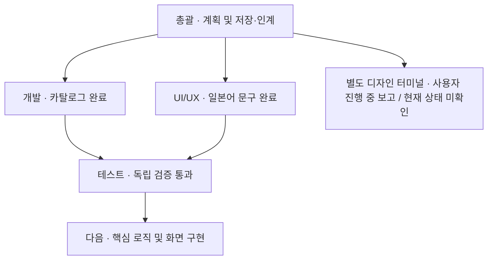

# POINT 재개·인계 기록

기준일: 2026-09-16. 총괄 작성. 현재 저장 대상 파일과 이 대화에서 확인된 결과를 기준으로 한다.

## 확정된 사용자 지시

- 앱 개발을 시작하고 총괄이 전문 에이전트에 독립 작업을 분배한다.
- 첫 플랫폼은 iPhone, 첫 언어는 일본어이다. 사용자 반응을 확인한 뒤 플랫폼·언어를 확장한다.
- 계산대에서 결제·포인트 앱을 찾는 시간을 줄인다. 매장 도착 시 그 매장에서 쓸 수 있는 본인 앱을 알림으로 안내하고 실행으로 연결한다.
- 첫 사용 과정에 위치 사용 목적 설명과 권한 요청을 포함한다.
- 병렬 작업과 에이전트별 진행상황을 시각화하고 주요 단계 완료 시 보고한다. 필요한 새 터미널 실행도 허용됐다.
- 환경 검증은 종료한다. 설정 로딩·샌드박스 미확인 사항은 실제 개발을 막을 때만 조사한다.
- 신규 Skill 설치, 외부 서비스 도입, 배포는 별도 승인 범위이다.

## 완료된 결과

| 산출물 | 내용 | 검증 |
| --- | --- | --- |
| 운영 문서·Codex 역할 설정 | 총괄과 6개 전문 역할, 소유권·검토·승인 체계 | 최초 독립 검토 및 설정 7개 TOML·참조 검사 통과. 기존 커밋 95ca6ee |
| docs/PRODUCT_PLAN.md | iPhone·일본어 첫 버전 단계별 계획 | 개발 구현 가능성·테스트 독립 문서 검토 |
| assets/catalog/demo_catalog.json | 가상 앱4개·매장3개, isDemo=true, 실행 URL 모두 null | JSON·고유 ID·참조 무결성 독립 검증 |
| assets/i18n/ja.json | 일본어72개 문구, 권한·빈 상태·샘플·오류·접근성 안내 | UTF-8·JSON·중복키·빈 문자열·필수 안내 독립 검증 |
| 별도 디자인 터미널 | UI/UX 역할 지침을 적용한 독립 Codex 세션 실행 | 생성 당시 새 PowerShell과 하위 Codex 프로세스 확인 |

실행 가능한 앱 코드·화면·iPhone 빌드·실기기 검증은 아직 완료되지 않았다. 가상 카탈로그는 실제 매장 지원 정보가 아니며 결제 앱을 실행하지 않는다.

## 에이전트 작업 현황

이는 저장 시점의 현황이다. 별도 터미널의 실시간 자동 동기화를 의미하지 않는다. 디자인 산출물은 현재 저장소 파일 목록에 없으며 외부 도구·미저장 화면 존재 여부는 미확인이다.

## 다음에 진행할 작업

1. Flutter + Dart 사용 여부와 주요 UI 방향에 관한 사용자 결정을 확인한다. 이미 다른 세션에서 결정됐다면 그 근거를 인계받고 반복 승인을 요구하지 않는다.
2. 디자인과 병렬로 보유 앱 선택·로컬 저장, 매장 검색, 지원 앱과 사용자 앱의 교집합 로직을 구현하고 독립 테스트한다.
3. 승인된 화면에 기능을 연결한다. 실제 위치 연결 전에는 샘플 표시를 유지하고 주변 매장인 것처럼 표시하지 않는다.
4. 실제 매장 데이터 출처·지원 앱·실행 링크를 검증한다. 위치·알림·앱 실행의 iPhone 연결은 실기기 검증으로 확인한다.
5. 구현 결과는 코드 리뷰 → 디버그 → 테스트 → 총괄 순서로 검토한다.

미결정: 무료·유료·프리미엄의 기능·가격, 실제 매장 범위·출처, 알림 탭의 직접 앱 실행/매장 상세 경로, 중복 알림 제한, OCR 범위. 기존 제안을 확정 요구로 바꾸지 않는다.

## 환경 조사 보존 기록 — 재조사 금지 기본값

- 총괄과 서브에이전트3개의 동시 running 상태를 실제 관찰했고 사용자가 정상 동작으로 인정했다.
- 조사 당시 현재 대화는 VS Code 터미널 계통의 Codex CLI 0.154.0이었다. Desktop·확장판 alpha 실행 파일도 별도로 존재했다. 현재 실행 중인 PID는 재조사하지 않는다.
- 같은 stable 실행 파일의 새 app-server 프로세스에서 프로젝트 설정 계층·출처를 확인했고, 새 세션이 프롬프트에 제공하지 않은 프로젝트 임시 식별자를 응답했다. 역할6개도 각 식별자 응답을 수집했으나 자식 역할 메타데이터 독립 대조는 사용자 중단으로 마치지 않았다.
- 검사 스크립트가 설정7개 원본 바이트 복구 성공을 보고했고 복구 후 새 프로세스에서 최상위 식별자 부재와 새 세션 ABSENT 응답을 확인했다. 현재 Git에서 설정 파일 변경은 없다. 추가 환경 검증은 하지 않는다.
- 샌드박스 오류 조사에서는 .codex 소유자가 CodexSandboxOffline, 상위·프로젝트 소유자가 user임을 확인했다. 현재 사용자 토큰의 .codex WRITE_DAC 열기만 오류5로 실패했다. 실패한 setup helper의 토큰 연결은 미확인이다.
- 권한 복구·소유자 변경·샌드박스 해제는 수행하지 않았다. 필요한 경우에도 구체적인 수정과 영향 범위를 보고한 뒤 승인받는다.

## 저장 범위

프로젝트 안의 완료된 문서·설정·리소스를 Git으로 보존한다. 대화의 결정과 주요 검증 결과는 이 문서와 DECISIONS.md에 요약한다. 계정 정보, 전체 대화 원문, 외부 임시 검사 스크립트·로그, 별도 터미널의 미확인 작업은 커밋 대상에 포함하지 않는다. 커밋 해시와 원격 반영 성공은 Git 이력과 최종 보고에서 확인한다.
